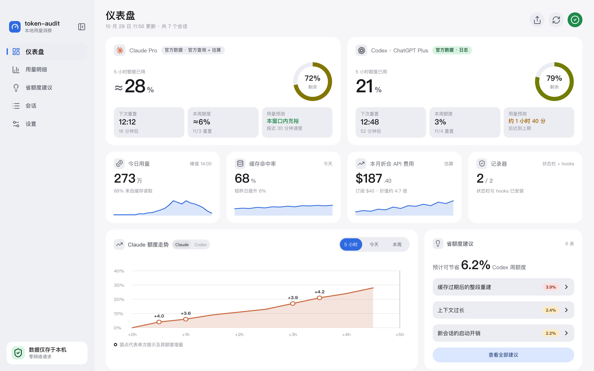

<div align="center">


# Tokmira

看清 Claude Code 和 Codex 的额度用在了哪里，以及为什么用得快。数据只留在本机。

**简体中文** · [English](README_en.md)

[](https://github.com/WenWangxin/Tokmira/releases/latest)
[](https://github.com/WenWangxin/Tokmira/releases)
[](LICENSE)
[](#下载)

[官网](https://wenwangxin.github.io/Tokmira/) · [下载](#下载) · [更新日志](https://github.com/WenWangxin/Tokmira/releases) · [隐私](#隐私) · [从源码构建](#从源码构建)

</div>

<p align="center">
  <picture>
    <source media="(prefers-color-scheme: dark)" srcset="snapshots/preview-dark.png">
    
  </picture>
</p>

> 原名 token-audit，现更名为 Tokmira。截图使用内置演示数据。

## 功能

- **额度现状**：Claude 和 Codex 的 5 小时与每周额度、重置时间和触顶预测。两次官方读数之间，按本机新增用量估算当前额度，并用 ≈ 标出。
- **额度去哪了**：按会话、项目、模型、子代理和单次提示拆分额度消耗，看清是哪一次提示用掉了额度。
- **省额度建议**：从本机日志识别缓存过期后的整段重建、上下文过长、轻量任务用了高价模型、一次提示跑了太多轮等 16 类浪费，写明多花了多少、下次怎么避免。
- **后台提醒**：关掉窗口后继续在菜单栏或托盘运行，刚出现费额度的用法就发一条系统通知。
- **菜单栏额度**：不打开窗口也能在菜单栏（macOS）或托盘提示（Windows）看到 5 小时额度。
- **会话与时间线**：每个会话的请求、提示和诊断标签按时间排开。
- **订阅值不值**：按 API 价格折算本月用量，生成可分享的卡片。
- **中英文界面**、开机自启、静默启动，以及可选的应用内更新。

> v1.2.0 起，诊断正文、会话标签和后台省额度提醒也跟随语言设置。命令行版仍默认输出中文。

## 下载

从 [GitHub Releases](https://github.com/WenWangxin/Tokmira/releases/latest) 下载最新版本。

| 平台 | 安装包 | 说明 |
| --- | --- | --- |
| macOS | `tokmira-<版本>-macos-universal.dmg` | Apple 芯片与 Intel 通用 |
| Windows 10 / 11（x64） | `tokmira-<版本>-windows-amd64-setup.exe` | 大多数电脑选这个 |
| Windows 10 / 11（ARM64） | `tokmira-<版本>-windows-arm64-setup.exe` | 骁龙等 ARM 架构笔记本 |

v1.3.0 起正式更名为 Tokmira，安装包使用 `tokmira-` 前缀；v1.2.0 及更早版本仍使用 `token-audit-`。仓库现为 `WenWangxin/Tokmira`，原仓库地址由 GitHub 跳转；命令行仍用 `token-audit`，已有数据和配置沿用。

安装包目前没有系统代码签名，也没有经过公证：

- **macOS**：首次打开时，在 Finder 里右键应用选择「打开」；如果仍被拦截，到「系统设置 → 隐私与安全性」里允许。
- **Windows**：出现 SmartScreen 时，选择「更多信息 → 仍要运行」。

**支持的工具**：命令行版和桌面版里的 Claude Code，命令行版和桌面版的 Codex。Claude 桌面端和网页的普通聊天、ChatGPT 聊天不在本机留下用量记录，所以不统计；官方额度里对不上的那部分会单独显示为「未归属」。

## 隐私

Tokmira 靠信任才有用，所以有三条不会改的原则：

1. **默认数据不出本机。** 用量分析只取本机日志里的用量与事件元数据，不上传对话内容。主动开启 Claude 官方额度查询时，登录令牌才会在内存中短暂使用，并且只发送给 Anthropic。
2. **核心逻辑开源。** 统计、归属和诊断的算法都在这个仓库里，可以自己复现结论。
3. **结论不受付费影响。** 任何人付费都不能改变诊断结果。

官方额度查询和检查更新需要你主动开启或操作：

- **Claude 官方额度查询**：读取本机 Claude 的登录令牌，只发往 Anthropic，令牌只在内存里使用，不保存、不刷新。
- **Codex 官方额度查询**：由本机 Codex 接口使用已登录账号向 OpenAI 查询；Tokmira 不读取登录令牌，本机日志分析可独立使用。
- **检查更新**：只从这个仓库的 GitHub Releases 下载更新清单和安装包，不附带版本号、设备信息或任何使用数据。

可选的 Claude Code 记录器（状态栏和 hooks）只记录额度百分比和提示时间，不记录提示内容。安装前会列出要改动的配置，并完整备份原文件；卸载时恢复原样。

## 使用

1. 安装后打开应用，首次引导会检测本机的 Claude Code 和 Codex，并说明每个数据来源。
2. Codex 的额度直接来自它的本地日志，不需要额外设置。
3. Claude 的精确额度二选一：在设置里开启「Claude 官方额度查询」，或者安装状态栏记录器（只适用于命令行版 Claude Code）。都不想开的话，也可以在设置里手动校准。

**命令行版**随安装包一起分发：macOS 在 `Tokmira.app/Contents/MacOS/token-audit`，Windows 在安装目录下的 `token-audit.exe`。常用命令：

```bash
token-audit scan --since 2026-10-01   # 汇总本机 Claude Code 与 Codex 的用量
token-audit advice --days 7           # 近 7 天的省额度建议
token-audit sessions --days 7         # 会话列表
token-audit quota codex               # 通过 Codex 本地接口读取官方额度
```

所有命令都支持 `--json` 输出；运行 `token-audit` 不带参数可以看到完整用法。

## 从源码构建

需要 [Rust](https://rustup.rs/) stable、[Node.js](https://nodejs.org/) 22 和 [pnpm](https://pnpm.io/)。

```bash
git clone https://github.com/WenWangxin/Tokmira.git
cd Tokmira
pnpm install
cargo build -p token-audit-cli   # 开发版桌面程序会调用它
pnpm tauri dev                   # 启动桌面应用
```

| 目标 | 命令 | 说明 |
| --- | --- | --- |
| macOS 通用包 | `pnpm bundle:mac` | 先分别构建两种架构的命令行程序并合并，再打包 `.app` 和 `.dmg` |
| Windows | `.\scripts\build-sidecar.ps1 -Target x86_64-pc-windows-msvc`，再 `pnpm tauri build --target x86_64-pc-windows-msvc --bundles nsis` | ARM64 换成 `aarch64-pc-windows-msvc` |

正式版由 [`.github/workflows/release.yml`](.github/workflows/release.yml) 在推送 `v*` 标签时构建，并发布到 Releases。开启了应用内更新时，打包需要更新签名私钥；本地自己构建的版本可以在 `src-tauri/tauri.conf.json` 里把 `bundle.createUpdaterArtifacts` 改为 `false`。

其他检查：

```bash
cargo test --workspace
pnpm -C ui typecheck
pnpm -C ui test
```

价格表和诊断阈值在 [`config/`](config) 目录里，按 API 价格估算，不是实际账单。

## 反馈

Bug 和功能建议请提交到 [GitHub Issues](https://github.com/WenWangxin/Tokmira/issues)。觉得有用的话，点一个 Star 是最简单的支持方式。

## 许可证

Tokmira 以 [MIT 协议](LICENSE)发布。
